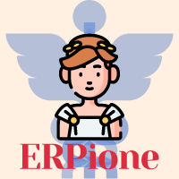

 
 

# Erpione

  

---

## About The Project
Erpione is an open-source **simulator for E‑Rezept client systems**. Most E‑Rezept
processes involve more than one system – a prescription is issued by a practice
management system (PVS) and later dispensed by a pharmacy system (AVS), with the
E‑Rezept backend in between. Erpione can step in on either side of that process
and act as the missing counterpart. It talks to the E‑Rezept backend exactly like a
real PVS, AVS or National Contact Point (NCPeH) would, so you can test your own
integration end‑to‑end without access to real partner systems.

Developed by gematik, the national competence center for digital health, Erpione
is used by gematik's own test teams and by vendors to validate client systems against the E‑Rezept
backend in the Reference (RU, RU-DEV) and Test (TU) environments.

### Why Erpione
- **Batteries included** – ships with pre‑configured test identities; runs purely in software – no Konnektor, card terminal or physical smartcards needed
- **Complete E‑Rezept workflow** – prescribe, accept, dispense, close, abort, charge items, communications etc.
- **FHIR optional** – plain domain inputs by default, Erpione takes care of FHIR; drop down to raw FHIR whenever you need full control
- **Web UI and REST API** – use it interactively for exploratory testing or script it for automated E2E tests
- **Synthetic test data** – realistic, FHIR‑conformant test data generated in seconds

For details on concepts, architecture and configuration, see the [Erpione Documentation](https://gematik.github.io/ERPione/).

## Release Notes
See [ReleaseNotes.md](./ReleaseNotes.md) for all information regarding the (newest) releases.

## Contributing
If you want to contribute, please check our [CONTRIBUTING.md](./CONTRIBUTING.md).

## License
Copyright 2021-2026 gematik GmbH

Apache License, Version 2.0

See the [LICENSE](./LICENSE) for the specific language governing permissions and limitations under the License

## Additional Notes and Disclaimer from gematik GmbH
1. Copyright notice: Each published work result is accompanied by an explicit statement of the license conditions for
   use. These are regularly typical conditions in connection with open source or free software. Programs
   described/provided/linked here are free software, unless otherwise stated.
2. Permission notice: Permission is hereby granted, free of charge, to any person obtaining a copy of this software and
   associated documentation files (the "Software"), to deal in the Software without restriction, including without
   limitation the rights to use, copy, modify, merge, publish, distribute, sublicense, and/or sell copies of the
   Software, and to permit persons to whom the Software is furnished to do so, subject to the following conditions:
   1. The copyright notice (Item 1) and the permission notice (Item 2) shall be included in all copies or substantial
      portions of the Software.
   2. The software is provided "as is" without warranty of any kind, either express or implied, including, but not
      limited to, the warranties of fitness for a particular purpose, merchantability, and/or non-infringement. The
      authors or copyright holders shall not be liable in any manner whatsoever for any damages or other claims arising
      from, out of or in connection with the software or the use or other dealings with the software, whether in an
      action of contract, tort, or otherwise.
   3. The software is the result of research and development activities, therefore not necessarily quality assured and
      without the character of a liable product. For this reason, gematik does not provide any support or other user
      assistance (unless otherwise stated in individual cases and without justification of a legal obligation).
      Furthermore, there is no claim to further development and adaptation of the results to a more current state of
      the art.
3. Gematik may remove published results temporarily or permanently from the place of publication at any time without
   prior notice or justification.
4. Parts of this software and - in isolated cases - content such as text or images may have been developed using the
   support of AI tools. They are subject to the same reviews, tests, and security checks as any other contribution. The
   functionality of the software itself is not based on AI decisions.

## Contact
E-Mail to [Medical Entwicklung](mailto:medical-entwicklung@gematik.de?subject=[GitHub]%20Erpione)
